# SDR4NOOB

**Всё в одном для начинающего радиолюбителя.**

Бесплатная программа для Windows, которая превращает любой USB радиоприёмник (SDR) в радио с поиском
станций, ТВ-измеритель, станцию приёма снимков со спутников и локатор самолётов. Например, RTL-SDR — для него
в программе есть встроенный драйвер. Всё по-русски, есть подробное руководство для начинающих.

> До версии 3.0 проект назывался **RtlTV**. Установленные копии обновляются сами: после обновления
> появится `SDR4NOOB.exe` (рядом остаётся `RtlTV.exe` — старые ярлыки продолжат работать),
> настройки и записи переедут автоматически.

**Сайт и руководство:** https://mike-ileech.github.io/SDR4NOOB/ ·
**Скачать:** [последний выпуск](https://github.com/Mike-iLeech/SDR4NOOB/releases/latest) ·
**Лицензия:** GPL-3.0-or-later

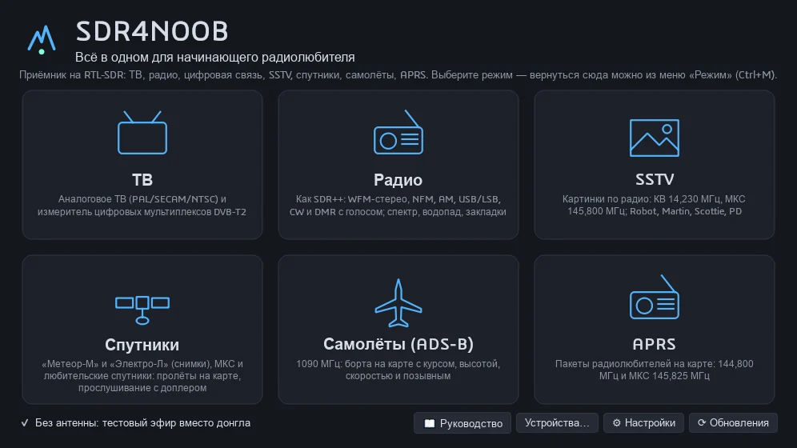

| Режим | Что делает |
|---|---|
| **Радио** | как SDR#/SDR++: спектр и водопад, WFM-стерео с RDS, NFM, AM, USB/LSB, CW, DMR с голосом, поиск DMR, менеджер частот, запись и воспроизведение IQ |
| **Спутники** | пролёты на карте (SGP4), снимки «Метеор-М» LRPT 72k/80k, «Электро-Л» LRIT, МКС и любительские спутники с доплером, свои спутники, галерея снимков |
| **Самолёты (ADS-B)** | 1090 МГц: карта OpenStreetMap, таблица бортов, журнал сообщений, история сеанса, карточки бортов с флагами, борта без координат |
| **ТВ** | аналоговое ТВ (ч/б, PAL/SECAM/NTSC) и измеритель мультиплексов DVB-T/T2 для наведения антенны |
| **SSTV** | Robot, Martin, Scottie, PD, Wraase; VIS, авто-наклон, галерея, декодирование WAV |
| **APRS** | пакеты радиолюбителей на карте: 144,800 МГц и МКС 145,825 МГц |

На экране выбора режима есть галочка **«Без антенны: тестовый эфир»** — синтетические сигналы для всех
режимов, чтобы изучить программу без приёмника.

## Скриншоты

| | |
|---|---|
| 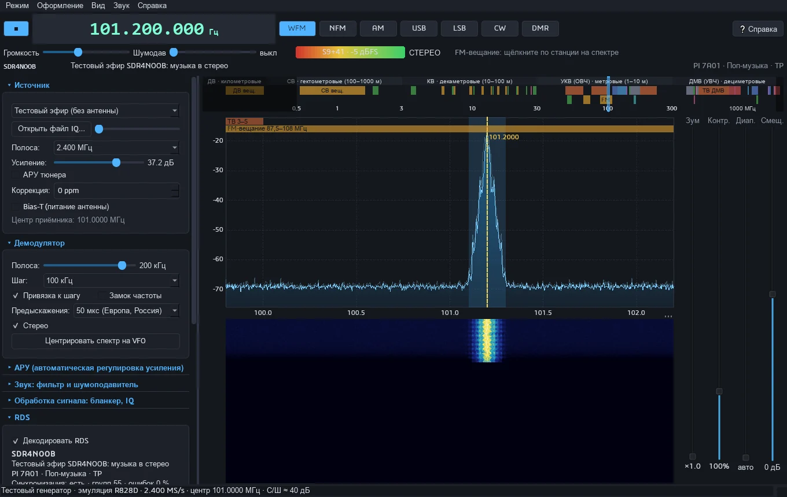 | 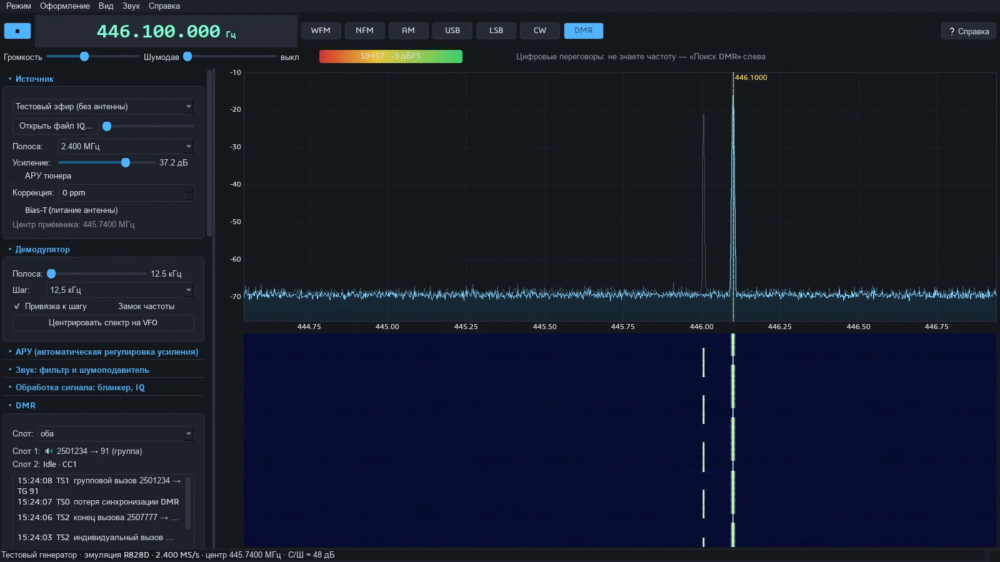 |
| Радио: WFM-стерео и RDS | Радио: DMR, слоты и вызовы |
| 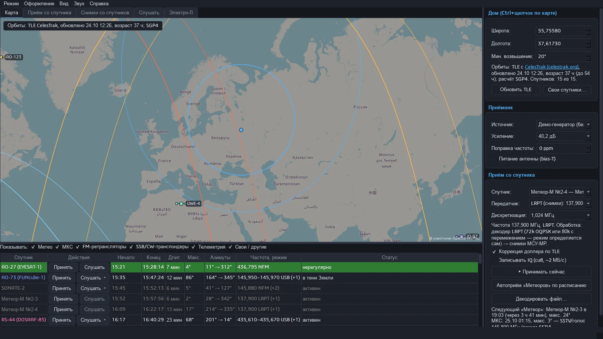 | 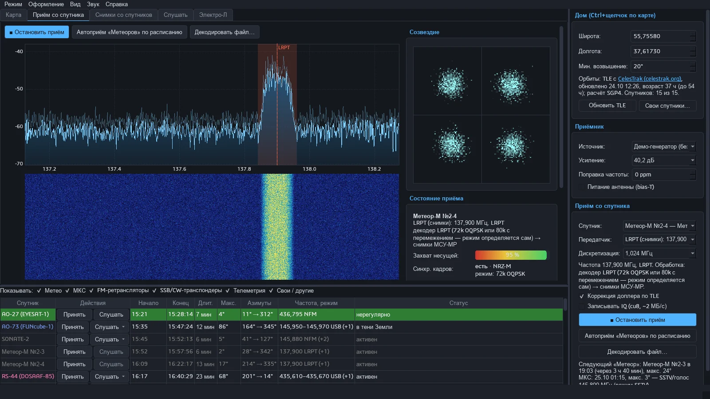 |
| Спутники: карта и таблица пролётов | Спутники: приём «Метеора», созвездие QPSK |
| 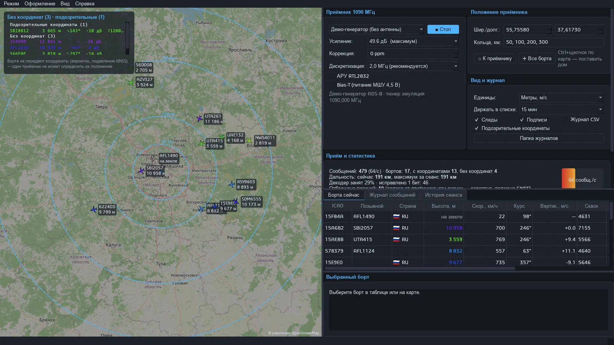 | 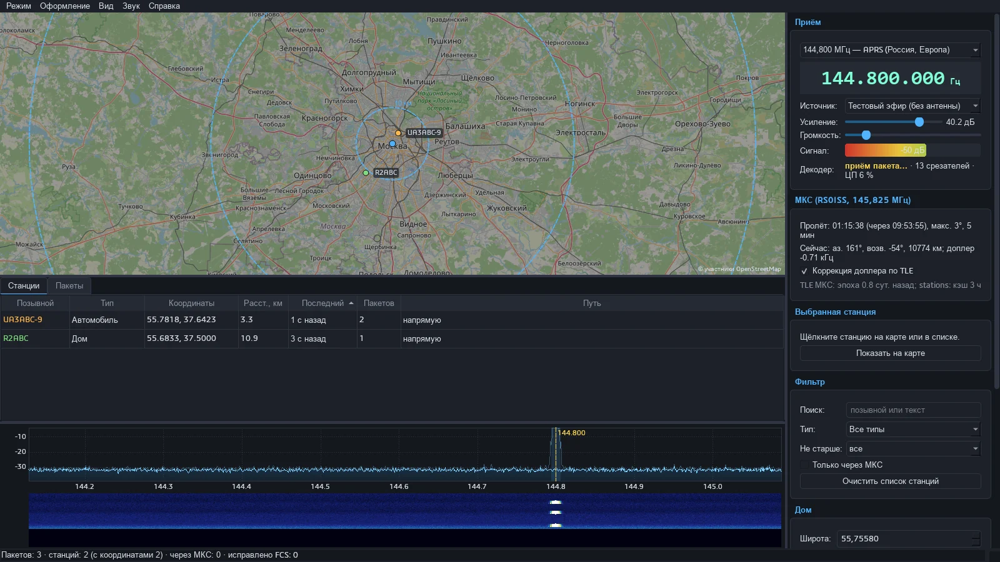 |
| Самолёты ADS-B | APRS |
| 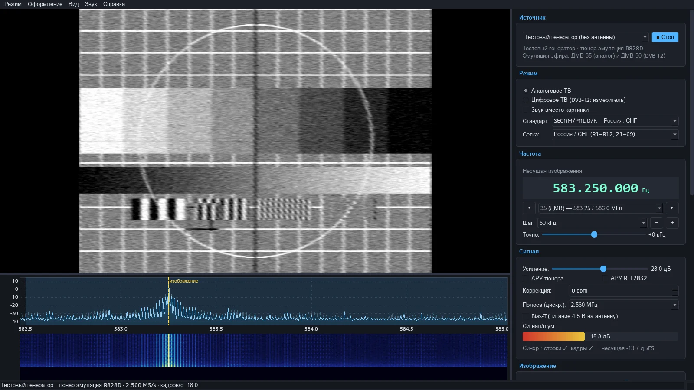 | 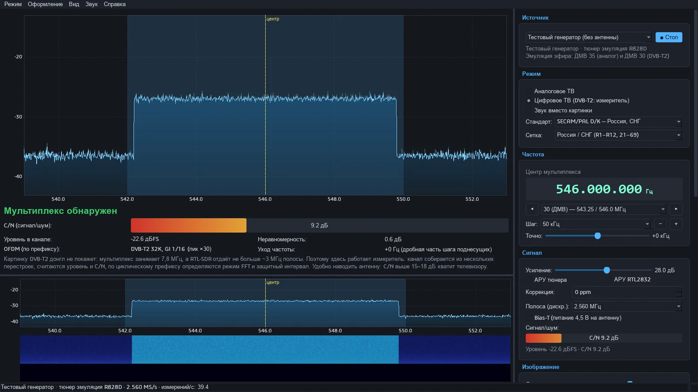 |
| ТВ: аналоговая картинка (тестовый генератор) | ТВ: измеритель DVB-T2 |
| 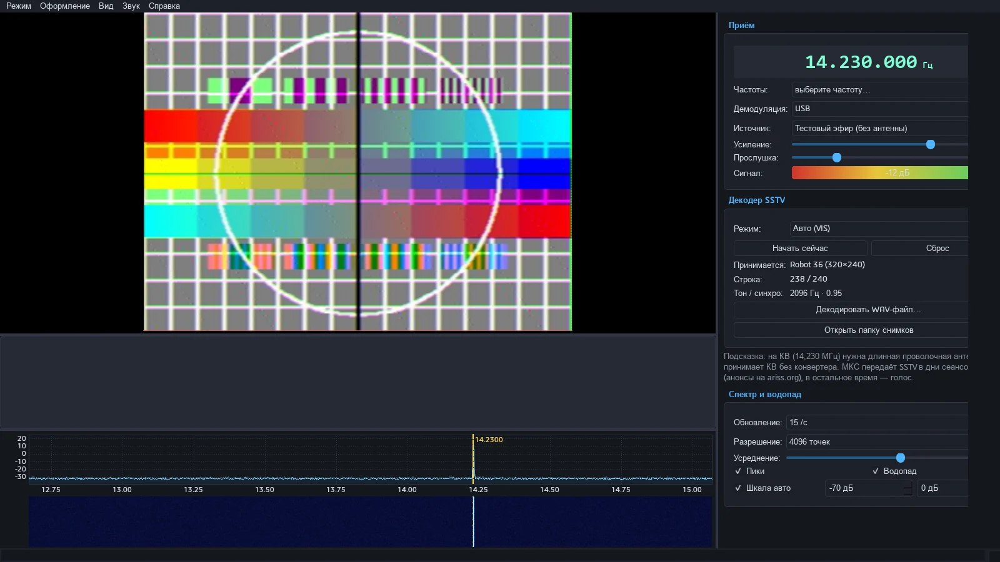 | 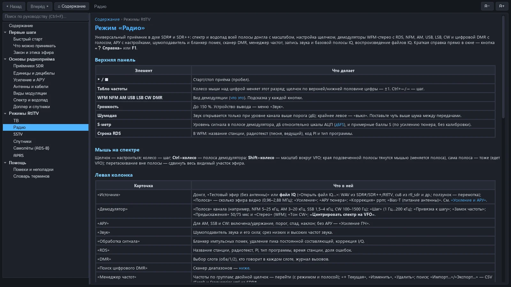 |
| SSTV: Robot 36 | Встроенное руководство |

Снимки сделаны на тестовом эфире (кроме «Реальный эфир» на сайте). Карты — © участники OpenStreetMap.

## Установка

Требования: **Windows 10/11 x64**, USB радиоприёмник (SDR): **RTL-SDR Blog V4/V3** или другой на RTL2832U
(встроенный драйвер), HackRF One, Airspy R2/Mini; или сетевой rtl_tcp. Python не нужен.

1. Скачайте **установщик** `SDR4NOOB-<версия>-setup.exe` со страницы
   [последнего выпуска](https://github.com/Mike-iLeech/SDR4NOOB/releases/latest) и запустите его.
   Программа не подписана, поэтому SmartScreen может предупредить: «Подробнее» → «Выполнить в любом случае».
2. В мастере выберите:
   - **папку программы** (по умолчанию `%LOCALAPPDATA%\Programs\SDR4NOOB` — права администратора не нужны);
   - **папку для ваших файлов** — записи, снимки, звук, журналы (по умолчанию `Документы\SDR4NOOB`);
   - **автообновление** — проверять новые версии раз в день или нет.
3. Запустите SDR4NOOB из меню «Пуск» или с рабочего стола. Удаление — «Параметры → Приложения»;
   ваши записи и настройки при этом остаются.

**Без установки:** архив `SDR4NOOB-<версия>-win64.zip` — распакуйте в любую папку с правами записи
(не в `C:\Program Files`) и запустите `SDR4NOOB.exe`.

Подробно, с картинками и ответами на вопросы — [«Установка и обновление»](https://mike-ileech.github.io/SDR4NOOB/install.html).

### Драйвер WinUSB (Zadig)

Librtlsdr (сборка [rtl-sdr-blog](https://github.com/rtlsdrblog/rtl-sdr-blog) с поддержкой V4) уже встроен
в SDR4NOOB — SDR# и системные драйверы ставить не нужно. Нужно лишь один раз привязать к донглу WinUSB:

1. Скачайте [Zadig](https://zadig.akeo.ie/) и запустите.
2. **Options → List All Devices**, выберите «Bulk-In, Interface (Interface 0)» или «RTL2838UHIDIR»
   (USB ID `0BDA 2838`).
3. Выберите **WinUSB** → **Replace Driver**.

Другие устройства в Zadig не трогайте. В другом USB-порту замену иногда приходится повторить. Если донгл
уже работал в SDR#, SDR++ или SatDump — этот шаг уже сделан. Проверка — кнопка «Устройства…» на экране
выбора режима.

### Первый запуск

- Экран выбора режима; вернуться к нему из любого режима — меню «Режим → Выбрать другой режим…» (**Ctrl+M**).
- **«Руководство»** — встроенная справка на 19 страниц (то же, что на сайте); **F1** в окне режима открывает
  страницу этого режима (в «Радио» F1 — краткая справка, руководство — «Справка → Руководство»).
- Начните с [«Быстрого старта»](https://mike-ileech.github.io/SDR4NOOB/guide/quickstart.html): FM-радио →
  самолёты → авиадиспетчеры за 10 минут.

## Режимы

### Радио
Спектр и водопад всей полосы (до 2,88 МГц), VFO щелчком, масштаб, перетаскивание полосы. Демодуляторы
WFM (стерео, предыскажения 50/75 мкс, RDS: название, радиотекст, PI, тип программы), NFM, AM, USB, LSB, CW,
**DMR** (номера абонентов и групп, слоты, цветовой код, голос через mbelib, значок 🔒 для шифрованных).
АРУ, шумодав, шумоподавитель звука, бланкер помех, коррекция I/Q.
- **Поиск цифрового DMR** — сканирует диапазон (70 см, PMR446, служебные, 2 м или свой), показывает
  активные частоты с типом сигнала; двойной щелчок — настройка.
- **Менеджер частот** — группы, встроенные диапазоны, импорт/экспорт CSV и Frequencies.xml из SDR#.
- **Запись** звука в WAV и базовой полосы IQ (WAV 16 бит или cu8); воспроизведение IQ-файлов из SDR#, SDR++,
  rtl_sdr и самого SDR4NOOB с перемоткой.

### Спутники
Прогноз пролётов по TLE с CelesTrak (SGP4), карта с трассами и зоной видимости, таблица пролётов с фильтром
по категориям.
- **«Метеор-М» №2-3/№2-4** — LRPT 137,9/137,1 МГц, OQPSK 72k и 80k с перемежением (режим определяется сам),
  коррекция доплера, автоприём по расписанию, запись IQ, декодирование файлов, композиты 221/125/123.
- **«Электро-Л»** — LRIT 1691 МГц (нужны тарелка и МШУ), декодирование файлов LRIT.
- **«Слушать»** — МКС и любительские спутники (FM-ретрансляторы, SSB/CW-транспондеры, телеметрия) с
  автоматической коррекцией доплера.
- **Свои спутники** по номеру NORAD (TLE с CelesTrak или вручную), со своими передатчиками и декодерами.
- **Галерея** всех принятых снимков.

### Самолёты (ADS-B)
1090 МГц: борта на карте с курсом, высотой и следами, кольца дальности, таблица «Борта сейчас», журнал
расшифрованных сообщений (DF17, DF4, DF11…), история сеанса, карточка выбранного борта (страна с флагом, тип и
оператор из adsbdb/hexdb), список бортов **без координат** и отбраковка подменённых позиций (подавление GNSS),
журнал CSV/KML.

### ТВ
Аналоговое ТВ SECAM/PAL D/K, PAL B/G, PAL I, NTSC M; сетки каналов России, Европы, Великобритании и США;
чёрно-белая картинка или звук, 9 палитр, снимок кадра (F12), полный экран (F11), поиск каналов.
Цифровой режим — **измеритель DVB-T/T2**: уровень, C/N, неравномерность «стола», режим FFT и защитный интервал по
циклическому префиксу, уход частоты.

### SSTV
Robot 36/72, Martin M1/M2, Scottie S1/S2/DX, PD 50–290, Wraase SC2-180. Автоопределение по VIS, авто-наклон,
живая прорисовка, галерея, декодирование записанных WAV. Пресеты КВ (14,230 МГц и др.) и МКС 145,800 МГц.

### APRS
AFSK 1200 бод → AX.25 → станции на карте с треками, лента пакетов с расшифровкой, фильтры, журнал в файл.
144,800 МГц и ретранслятор МКС 145,825 МГц (RS0ISS) с коррекцией доплера.

### Ограничения
- **DVB-T2 картинки нет:** в программе нет декодера DVB-T2, а режим ТВ работает в полосе до 3,2 МГц
  (это максимум RTL-SDR) при ширине мультиплекса 7,8 МГц — с любым приёмником. Цифровой режим — измеритель для наведения антенны.
- **Аналоговое ТВ в России выключено** с 2019 года; картинка ч/б (цветовая поднесущая не помещается в полосу),
  звук и картинка одновременно не принимаются. На тестовом генераторе: ДМВ 35 — аналог, ДМВ 30 — DVB-T2.
- **«Метеор»** требует антенны на 137 МГц (V-диполь, QFH) на открытом месте и тихого эфира; «Электро-Л» —
  тарелки и МШУ.
- Один VFO; dPMR, NXDN, TETRA, P25, D-STAR, System Fusion и APRS 9600 бод не декодируются.
- SDR4NOOB только принимает. Слушать служебные переговоры можно, разглашать — нельзя.

## Настройки и файлы

- **«Настройки»** (кнопка на экране выбора режима): папка данных, перенос файлов из прежних мест, частота
  проверки обновлений.
- Папка данных (по умолчанию `Документы\SDR4NOOB`): `Записи IQ`, `Снимки\ТВ|Метеор|Электро-Л|SSTV`, `Звук`,
  `Журналы\ADS-B|APRS`.
- Настройки: `%APPDATA%\SDR4NOOB\*.json`.
- Служебное (кэш карт, TLE, история самолётов, справочник бортов, драйверы, журнал `sdr4noob.log` и отчёты о
  зависаниях): `%LOCALAPPDATA%\SDR4NOOB` — или внутри папки данных, если так выбрано в «Настройках».
- Меню «Оформление» — 5 цветовых схем: тёмная, светлая, ночная красная, матрица, ретро-янтарь.

## Устройства

«Устройства…» на экране выбора режима показывает подключённые USB-приёмники, их VID:PID и драйвер Windows.
- **RTL-SDR** — встроенный librtlsdr (или выбранная своя DLL).
- **HackRF One / Airspy R2, Mini** — «Загрузить драйвер (DLL)…»: `hackrf.dll` или `airspy.dll` плюс
  `libusb-1.0.dll` и `pthreadVC2.dll` (берутся из официальных сборок этих проектов).
- **rtl_tcp** — приёмник на другом компьютере («Добавить сетевой rtl_tcp…»), также совместимые серверы вроде
  rsp_tcp для SDRplay.

## Автообновление

SDR4NOOB проверяет новую версию на GitHub Releases (по умолчанию раз в день; в «Настройках» — раз в неделю или
никогда), вручную — «Справка → Проверить обновления…». «Обновить сейчас» скачивает
`SDR4NOOB-<версия>-win64.zip`, сверяет SHA-256, после выхода программы заменяет файлы (прежняя версия
восстанавливается при ошибке) и перезапускает SDR4NOOB. Настройки и данные не затрагиваются.

## Сборка из исходников

Нужен Python 3.12 x64 для Windows.

```bat
:: запуск из исходников
py -3.12 -m pip install numpy scipy PySide6-Essentials sounddevice sgp4
py -3.12 -m rtltv                 :: или SDR4NOOB.bat
py -3.12 -m rtltv --test          :: тестовый эфир вместо приёмника
py -3.12 -m rtltv --mode radio    :: сразу открыть режим: tv, radio, sstv, sat, adsb, aprs
```

Ключи: `--test`, `--mode <режим>`, `--digital` и `--freq <МГц>` (ТВ), `--auto` (Спутники: автоприём),
`--shot <png> --shot-delay <с>` (снимок окна и выход — для автотестов).

Сборка EXE (`dist\SDR4NOOB\SDR4NOOB.exe`) в чистом окружении, чтобы не раздувать сборку:

```bat
py -3.12 -m venv .venv-build
.venv-build\Scripts\pip install numpy scipy PySide6-Essentials sounddevice sgp4 pyinstaller
build.bat
```

Готовые DLL лежат в `rtltv\driver\` (librtlsdr, mbelib, lrpt_dsp). Пересобрать свои: `tools\build_mbelib.bat`
(исходники mbelib), `tools\build_lrpt_dsp.bat` (MSVC x64, исходник `tools\lrpt_dsp.c`).

Сайт (GitHub Pages из `docs/`) собирается из встроенного руководства:

```bat
py -3.12 tools\build_site.py --check
```

## Тесты

```bat
py -3.12 -m pip install pytest pyflakes
py -3.12 -m pytest -q tests
py -3.12 -m pyflakes rtltv tests tools
```

Тесты работают без приёмника и без окон (`QT_QPA_PLATFORM=offscreen`) и не трогают настройки пользователя
(`APPDATA` подменяется на временную папку).

## Структура проекта

```
rtltv/__main__.py        точка входа и ключи командной строки (run.py — для PyInstaller)
rtltv/launcher.py        экран выбора режима, переключение режимов
rtltv/modebase.py        базовое окно режима: меню, звук, тема, снимок окна
rtltv/app.py             режим «ТВ»; analog.py, digital.py, standards.py, testsignal.py
rtltv/modes/             окна режимов: radio_window, sat_window (+ sat_gallery, sat_userdlg, sat_widgets),
                         adsb_window, aprs_window, sstv_window, dmr_scan_panel, radio_panels
rtltv/radio.py           VFO и демодуляторы; rds.py, dmr.py, dmrscan.py, freqman.py, iqfile.py, radiotest.py
rtltv/lrpt.py            «Метеор-М» LRPT; elektro.py — «Электро-Л» LRIT; satpass.py, satcat.py, satrx.py
rtltv/adsb.py            ADS-B/Mode S; aircraft_info.py — карточки бортов; mapview.py — карта OSM
rtltv/aprs.py, sstv.py   декодеры APRS и SSTV
rtltv/rtlsdr.py          ctypes-обёртка librtlsdr; rtl_stream.py, source.py, devices.py, devices_dialog.py
rtltv/engine.py          очередь блоков и поток обработки; audio.py, radio_audio.py — вывод звука
rtltv/updater.py         автообновление; update_ui.py — его окна; settings*.py, paths.py — настройки и папки
rtltv/guide/             встроенное руководство (HTML + SVG); guide_window.py — окно просмотра
rtltv/driver/            librtlsdr.dll, mbelib.dll, lrpt_dsp.dll
tools/                   build_site.py (сайт), lrpt_dsp.c и bat-файлы сборки DLL
tests/                   pytest
docs/                    сайт GitHub Pages (собирается tools/build_site.py; снимки — docs/img/screens)
```

## Лицензия

SDR4NOOB распространяется под лицензией **GPL-3.0-or-later** (файл [LICENSE](LICENSE)).
Сторонние компоненты и их лицензии — в [THIRD_PARTY.md](THIRD_PARTY.md): librtlsdr (rtl-sdr-blog,
GPL-2.0-or-later), mbelib (ISC), Qt/PySide6 (LGPL-3.0), numpy и scipy (BSD), sgp4 (MIT),
sounddevice/PortAudio (MIT), PyInstaller (GPL с исключением для загрузчика), данные OpenStreetMap, CelesTrak,
adsbdb, hexdb, flagcdn.

Декодирование голоса DMR использует mbelib (AMBE+2). Алгоритмы AMBE могут быть защищены патентами в
некоторых странах — используйте эту функцию на свой страх и риск.

## Благодарности

- [rtl-sdr-blog](https://github.com/rtlsdrblog/rtl-sdr-blog) и Osmocom — librtlsdr и донгл V4.
- [mbelib](https://github.com/szechyjs/mbelib) — вокодер AMBE для голоса DMR.
- [SatDump](https://github.com/SatDump/SatDump) — эталон параметров и проверки декодеров LRPT и LRIT.
- SDR# и SDR++ — образцы интерфейса режима «Радио».
- [OpenStreetMap](https://www.openstreetmap.org/copyright), [CelesTrak](https://celestrak.org/),
  [adsbdb](https://www.adsbdb.com/), [hexdb.io](https://hexdb.io/), [flagcdn](https://flagcdn.com/) — данные.
- [Zadig](https://zadig.akeo.ie/) — установка WinUSB.
